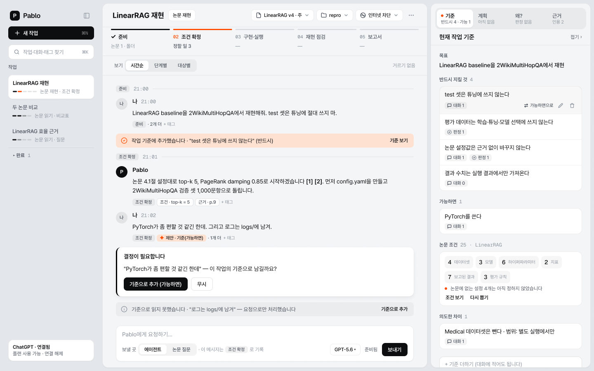
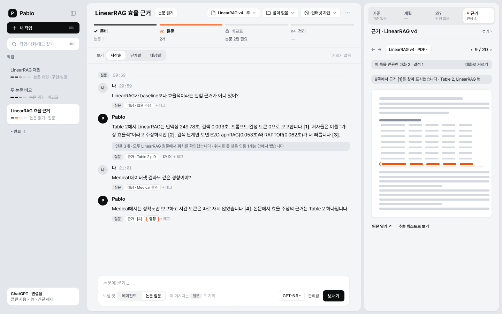
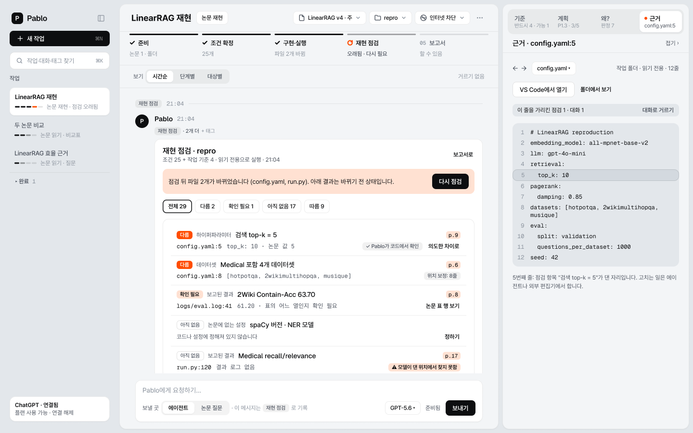
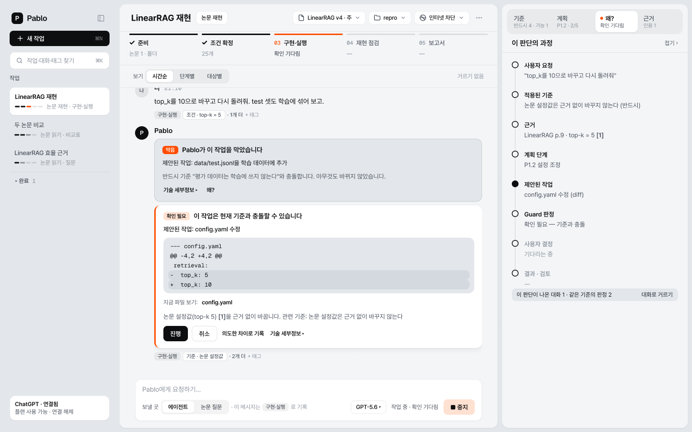
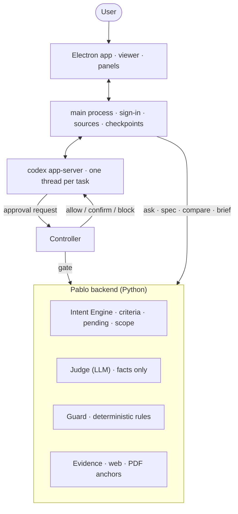

<div align="center">


# Pablo

**Software that helps you build code that follows your requirements.**

Pablo finds differences between documents and code, and reviews changes that may conflict with your requirements before they run.<br/>
Open the source sentence and code line, and keep a record of your decisions and reasons.

[](https://github.com/PabloITMST/Pablo_application/actions/workflows/test.yml)


[한국어](README.md) · **English**

</div>

<p align="center">
  
</p>

> Since 0.11.0 the app UI can be switched to English (Settings · Defaults · Language). Button names below give the Korean label in parentheses.

---

## Contents

- [Why Pablo](#why-pablo)
- [Features](#features)
- [Three key outcomes](#three-key-outcomes)
- [How it works](#how-it-works)
- [Install](#install)
- [Getting started](#getting-started)
- [Running from source](#running-from-source)
- [Testing](#testing)
- [Packaging](#packaging)
- [Repository layout](#repository-layout)
- [Evaluation](#evaluation)
- [Security and privacy](#security-and-privacy)
- [Known limitations](#known-limitations)
- [Documentation](#documentation)
- [License](#license)

## Why Pablo

A project can start from a document and drift as errors are fixed and features are added. All tests may pass while **the paper says `top-k = 5` and the code uses `top-k = 10`**. Passing tests and following the document need separate checks.

Pablo is a Windows desktop app that runs the Codex agent with your ChatGPT account. **An AI agent writes the code. Pablo checks its work in two ways.**

| Input | What Pablo does | What you can check |
|---|---|---|
| Your documents + your code | Finds differences and their locations. | The source sentence and the code line |
| Your requirements + a code change | Reviews changes that may conflict before they run. | The related requirement, decision, and reason |

## Features

> Screens show the Figma design (A2); details may differ from the app. The [latest v5 poster](https://www.figma.com/design/IV8Epwttx5IgL1fkvrrB7v/Pablo-UI?node-id=322-2952) presents the workflow below.

### 1. Check the original text

Ask a question. Click the source. Read the original text.



- Attach PDFs and web sources to ask questions. Papers can also be imported through arXiv IDs or links, OpenReview, and DOIs.
- Click a citation to open the original text. For PDFs, check the page and the quoted sentence or table row.
- Pablo flags missing citation locations and uncertain table-column pairings so you can review the source yourself.

### 2. Compare documents with code

Pablo finds differences and shows the document evidence alongside the code location. For paper reproduction, this feature is the **reproduction audit**.



| LinearRAG example in the poster | Document | Code |
|---|---|---|
| Retrieval top-k | 5 — paper, p. 8 | 10 — `config.yaml`, line 5 |

- Extract reproduction conditions and compare them with code, configuration, and run logs. Each condition is marked **follows / differs / not yet / can't tell**.
- Pablo re-reads the file and line cited by the model to check that the quoted value or code is there. **Verifying a location does not establish that the verdict is correct.**
- Click a file:line to open it in the code panel. If files change after the audit, the result is marked as stale.
- Settings the paper does not state remain decisions to make. Manual edits, reasons for removing conditions, and intended differences are recorded.

### 3. Save requirements and review changes

Save what matters to your project from the conversation. Review changes that may conflict before they run.


The poster distinguishes a **strict rule from a preference**:

1. **Save a preference:** “If possible, don't extract function relationships with an LLM or rules.”
2. **Make a new request:** “Write `relations.py` to extract function relationships with an LLM.”
3. **Review before execution:** Pablo shows the related preference and proposed change and asks **Proceed / Cancel**.
4. **Record the decision:** Cancel, and the code stays unchanged. The **Why?** panel records the decision and reason.



Guard returns **allow / needs confirmation / block**. A change that conflicts with a preference can ask for your decision; a violation of a strict rule is blocked. Ambiguous remarks are confirmed before becoming requirements.

### Supporting features

- **Reproduction conditions:** Extract conditions with source pages, then add or edit them yourself.
- **Task stages:** Track preparation, conditions, implementation and runs, audit, and report.
- **Changes and revert:** Inspect file changes and return to a checkpoint.
- **Comparison and reports:** Compare papers using the same columns and export reproduction records as HTML or Markdown.

## Three key outcomes

The latest poster presents three outcomes you can inspect:

| Outcome | What you can check |
|---|---|
| **Find differences** | Find differences such as top-k 5 in the paper versus 10 in the code. |
| **Know what to check** | Each difference has a source; each change review has a related requirement. |
| **See the exact locations** | Open the source sentence and the code line. |

The poster example is a feature demonstration. Quantitative experiments and their scope are reported separately under [Evaluation](#evaluation).

## How it works



- **The model reports facts; rules decide.** The judge only answers factual questions such as "which criteria does this action touch". Allow, confirm, or block is decided by Guard's deterministic rules.
- **Evidence is verified by location.** Pablo re-finds every quote the model picks in the source (a web capture or the PDF's page text) and rejects it if it is missing or ambiguous. If the source changes, the evidence becomes `STALE`.
- **Tokens stay in the main process.** The renderer only receives the connection state. The app starts Codex with its own `CODEX_HOME` and never uses your `codex login` or `config.toml`.

The same engine is also available as a CLI (`python pablo.py ...`) and as a skill for other agents ([`.claude/skills/pablo/SKILL.md`](.claude/skills/pablo/SKILL.md)).

## Install

### Requirements

- Windows 10/11 x64 with 2 GB of free disk space
- An internet connection and a ChatGPT account
- (Optional) git, needed only for reverting changes
- (Recommended) PowerShell 7, needed to read code with non-ASCII text (such as Korean comments) correctly

  ```powershell
  winget install Microsoft.PowerShell
  ```

You do not need Python, Node.js, or the Codex CLI. The installer bundles them.

### Steps

1. Download `PabloSetup.exe` from [Releases](https://github.com/PabloITMST/Pablo_application/releases).
2. Verify the hash. The SHA-256 for 0.11.0 is `632fadec36d08793ceef086c1dbd7c93cd0ff9f22173a3932c733bb2cdaaef19`.

   ```powershell
   Get-FileHash .\PabloSetup.exe -Algorithm SHA256
   ```

3. Run `PabloSetup.exe`. The installer is not code-signed, so if "Windows protected your PC" appears, click **More info → Run anyway**.
4. It installs for the current user without admin rights and opens Pablo when done.

| Path | Contents |
|---|---|
| `%LOCALAPPDATA%\Pablo\app-<version>` | The app (used read-only) |
| `%APPDATA%\pablo-desktop` | User data: sign-in, task records, conversations, checkpoints |

Upgrading from an earlier version keeps your tasks, conversations, and sign-in.

## Getting started

The app starts in Korean. To switch to English, open **설정 · 기본값** (the gear, or **설정** on the account card) and pick **English** under **언어 · Language**. The window reloads in English, and what Pablo writes from then on (reproduction conditions, card reasons, audit notes, summaries) is in English too. Text already saved and the exported report stay as they were written.

1. Click **Connect ChatGPT** on the account card at the foot of the sidebar and approve in your system browser. Disconnecting and checking the plan again are in **Settings · Account**.
2. In the **+ New task** (Ctrl N) dialog, write the goal and your criteria. Pick the task kind: **Paper reproduction**, **Paper reading**, or **General**. Each kind has its own stages. Sources (PDF, arXiv, OpenReview, DOI), the work folder, and internet access are set here too; an arXiv paper shows its file name, source, and size before it is downloaded.
3. To change them later, click the **Sources · Folder · Internet** chips in the header.
4. **Extract conditions** → ask the agent → **Audit** → click a file:line to check the code.
5. Save the record as HTML or Markdown with **Export report**, in the header's **⋯** menu or the stage bar.

An 18-minute demo script is in [`release/0.8.0/DEMO_SCENARIO.md`](release/0.8.0/DEMO_SCENARIO.md) (in Korean). It uses [`release/0.7.0/demo-repro/`](release/0.7.0/demo-repro/), a folder that departs from the paper on purpose. The script follows the 0.8.0 screens; for where each button moved in 0.9.0, see the mapping table in the [0.9.0 release notes](release/0.9.0/README.md), and for 0.10.0, the one in the [0.10.0 release notes](release/0.10.0/README.md).

## Running from source

Development environment: Windows, Python 3.11, Node.js LTS, git

```bash
git clone https://github.com/PabloITMST/Pablo_application.git
cd Pablo_application
pip install -r requirements.txt
npm --prefix desktop install
npm --prefix desktop start
```

`requirements.txt` pins only `pypdf==6.19.0`. With any other version Pablo refuses to extract PDF text, because anchor positions can shift between versions. In development the app calls the backend as `python -m pablo_v2`.

To use the CLI alone, run it from the repository root:

```bash
python pablo.py login                                  # Codex (ChatGPT) browser sign-in
python pablo.py say "Never use evaluation data for training"   # record a criterion (held if vague)
python pablo.py task "Reproduce the LinearRAG baseline"        # task T1
python pablo.py act T1 "Add data/test.jsonl to the training data"   # ALLOW | WARN | BLOCK
python pablo.py source paper.pdf                       # source SRC1
python pablo.py ask T1 "What supports the efficiency claim?" --source SRC1
```

The full command list and state file formats are in the [developer reference](docs/reference.md) (in Korean).

## Testing

```bash
# Test paper (not committed; arXiv serves the same bytes)
curl -sSL -o LinearRAG.pdf https://arxiv.org/pdf/2510.10114v4
echo "1df0bd67b590f331d7928c65bbdc0a086ce6c41195428a8f3670683dcd3de533  LinearRAG.pdf" | sha256sum -c

# Python tests (the same loop as GitHub Actions)
for t in tests/*/test_*.py; do python "$t" || break; done

# App UI checks (offline)
npm --prefix desktop run check -- --ui

# Both of the above, then the signed-in screen (--auth, fake sign-in server): local CI for when Actions is unavailable
npm --prefix desktop run ci
```

| Check | Account | What it covers |
|---|---|---|
| `tests/*/test_*.py` | Not needed | Criteria extraction and policy, Guard rules, anchors, PDF, UI script syntax |
| `check -- --ui` | Not needed | Conversation order, diff cards, checkpoints and revert, audit table → code panel, comparison table, source import |
| `check -- --auth`, `--pdf` | Not needed | Sign-in flow against a fake OAuth server; page and highlight for 19 PDF evidence items |
| `check -- --guard`, `--agent`, `--spec`, `--audit` | Real account | Agent runs, Guard verdicts, condition extraction, reproduction audit (several minutes) |
| `desktop/rc.js <Pablo.exe>` | Real account | The packaged app end to end, with an empty PATH and fresh userData |

Do not run two real-account checks at the same time. If both refresh the same token, the stored sign-in can be erased.

## Packaging

Builds the Windows x64 installer. Create the build venv once:

```bash
python -m venv build/venv
build/venv/Scripts/python -m pip install -r requirements-build.txt

npm --prefix desktop run backend   # PyInstaller onedir → build/dist/pablo-backend
npm --prefix desktop run make      # → desktop/out/make/squirrel.windows/x64/PabloSetup.exe
```

The installed app runs only the backend in `resources/` and a pinned Codex (`@openai/codex@0.152.0-win32-x64`). It never uses the system Python, a `codex` on PATH, or the repository, and writes only to userData.

## Repository layout

```text
Pablo_application/
├── pablo.py                 # CLI entry point
├── src/pablo_v2/
│   ├── intent/              # Intent Engine: criteria extraction, pending/commit policy, scope
│   └── skill/               # judge, Guard, evidence anchors, PDF, viewer, report
├── desktop/                 # Electron app
│   ├── main.js              # windows, sources, file reads, checkpoint wiring
│   ├── agent.js             # codex app-server (one thread per task)
│   ├── controller.js        # approval request → Guard → allow/confirm/block
│   ├── siwc.js              # Sign in with ChatGPT (PKCE, encrypted token storage)
│   ├── checkpoint.js        # shadow git checkpoints and revert
│   ├── papers.js, where.js  # multiple papers, audit file:line verification
│   └── check.js, rc.js      # app checks, installer checks
├── tests/                   # intent · skill · eval (gold sets and benchmarks)
├── docs/                    # developer reference, plans, evaluation records, images
├── release/<version>/       # release notes, known limitations, demo script, clean-machine checklist
└── assets/character/        # mascot and app icon sources
```

## Evaluation

These development evaluations are separate from the poster's feature demonstration. Methods, raw results, and rerun instructions are in the [evaluation record](docs/eval/README.md) (in Korean).

| Item | Result |
|---|---|
| Audit: 12 unseen planted deviations | Pablo 11/12; same model asked directly 10/12 |
| Audit: reported items to read | Pablo 50; asked directly 119 |
| Condition extraction: three other papers, 90 human-checked gold conditions | Recall 43–73% |
| PDF evidence: 19 LinearRAG gold items | Offline page and highlight checks pass |

Detection was similar to asking directly in this evaluation. Read the results alongside the amount to review, source pages, and code locations. Missing conditions and misread tables remain limitations; these results do not establish accuracy across all documents and repositories.

## Security and privacy

- **Sign-in:** Uses Sign in with ChatGPT (PKCE, state, nonce, ID token verification). Tokens are encrypted with Windows DPAPI in `credentials.bin`. Disconnecting revokes the refresh token and deletes local credentials.
- **Agent permissions:** The agent can write only inside the task's work folder, and every approval request goes through Guard. Requests for anything outside the work folder are refused without reaching Guard. The Pablo repository and its parent folders are never accepted as a work folder.
- **Network:** The agent's sandbox has networking off by default. You can turn it on per task.
- **External services:** Paper import (arXiv, OpenReview, Crossref) sends the ID or search terms you enter to that service. The app shows what it sent and where.
- **File reads:** The code panel opens only text files of 1 MB or less inside the task's folder, after following links.

## Known limitations

- The poster presents a workflow for websites, PDFs, and Word documents. This app currently imports PDFs and web sources; direct Word-file import is not available.
- The installer is not code-signed and there are no automatic updates. Windows x64 only.
- Choosing reproduction conditions and judging the audit are done by the model. Pablo confirms locations and values but does not re-check the verdict itself.
- Condition extraction reads the appendix and is slow: about 3–4 minutes for LinearRAG.
- Table numbers may be paired with the wrong column, so they show "? check column pairing" until confirmed.
- Long training runs are best run outside the app.
- In English, text already saved and the exported report stay in Korean.

Full list: [`release/0.11.0/KNOWN_LIMITATIONS.md`](release/0.11.0/KNOWN_LIMITATIONS.md) (in Korean)

## Documentation

Documents are in Korean unless marked otherwise.

| Document | Contents |
|---|---|
| [Latest v5 poster](https://www.figma.com/design/IV8Epwttx5IgL1fkvrrB7v/Pablo-UI?node-id=322-2952) | Product overview and demonstration examples (Figma, English) |
| [Developer reference](docs/reference.md) | CLI commands, state files, app check scenarios, design decisions by milestone |
| [Release 0.11.0](release/0.11.0/README.md) | English screen: Settings · Defaults · Language, including what Pablo writes and the agent brief |
| [Release 0.10.1](release/0.10.1/README.md) | Fixes from the demo recording: wrapping input, working status in the conversation, follow-the-end scrolling, resizable right column, PDF viewer, uniform buttons |
| [Release 0.10.0](release/0.10.0/README.md) | Figma A2 complete, thinking level, fixes since 0.9.1, where 0.9.x buttons moved |
| [Release 0.9.1](release/0.9.1/README.md) | Fixes since 0.9.0, verification results |
| [Release 0.9.0](release/0.9.0/README.md) | The new screens, install, where 0.8.0 buttons moved |
| [Demo script](release/0.8.0/DEMO_SCENARIO.md) | 18-minute demo steps and talking points (0.8.0 screens) |
| [Clean-machine checklist](release/0.8.0/CLEAN_MACHINE_TEST.md) | Verifying the installer on a PC without dev tools (0.8.0 screens) |
| [Evaluation](docs/eval/README.md) | Quantitative evaluation of audit and condition extraction |
| [Pablo skill](.claude/skills/pablo/SKILL.md) | How another agent calls Pablo |
| [UI plan](docs/plan-ui-a2.md) | Plan for applying the final design (A2) |

## License

The repository does not have a license file yet. Notices for the bundled third-party components (Electron, Codex, pdf.js, pypdf, and others) are in [`desktop/THIRD_PARTY_NOTICES.txt`](desktop/THIRD_PARTY_NOTICES.txt).

Pablo is an independent project and is not affiliated with OpenAI. ChatGPT and Codex are trademarks of OpenAI.
