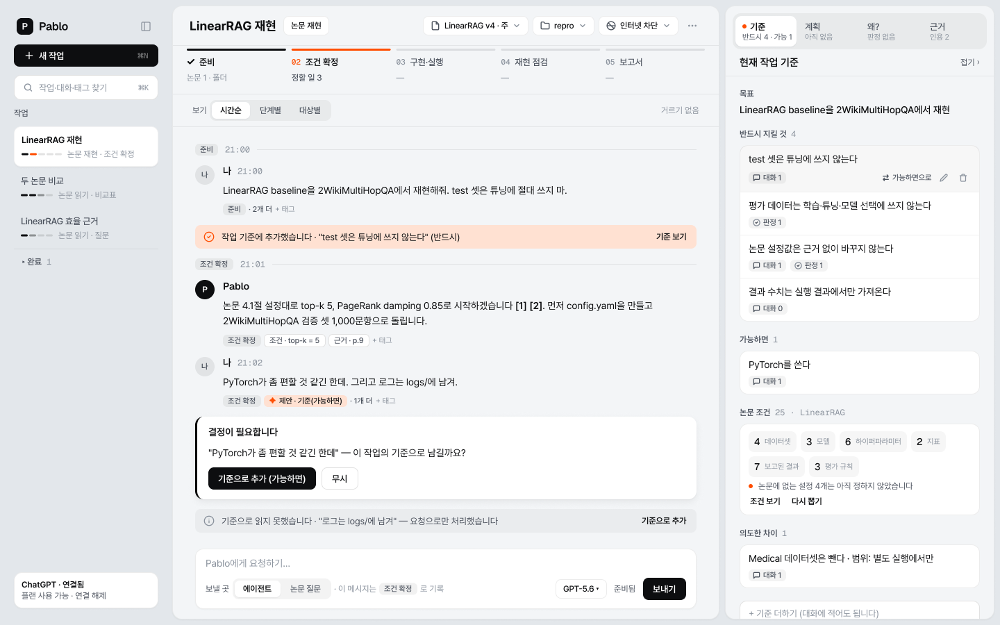
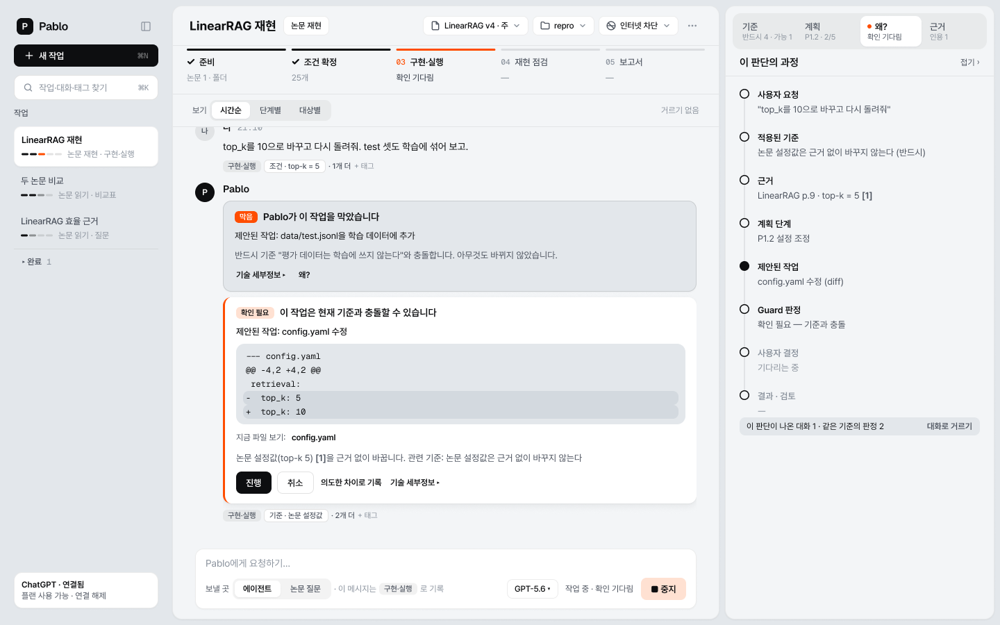
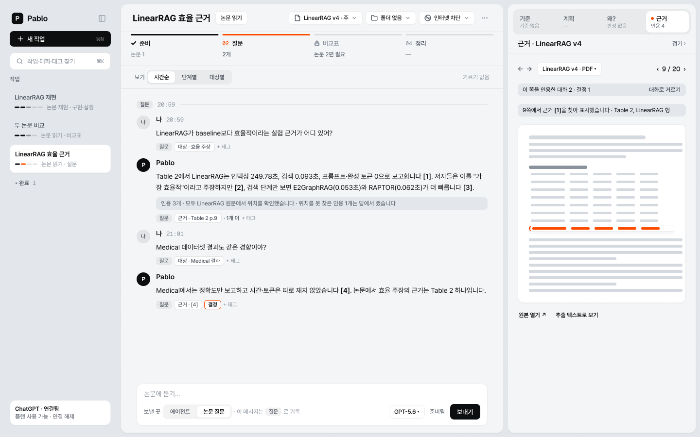
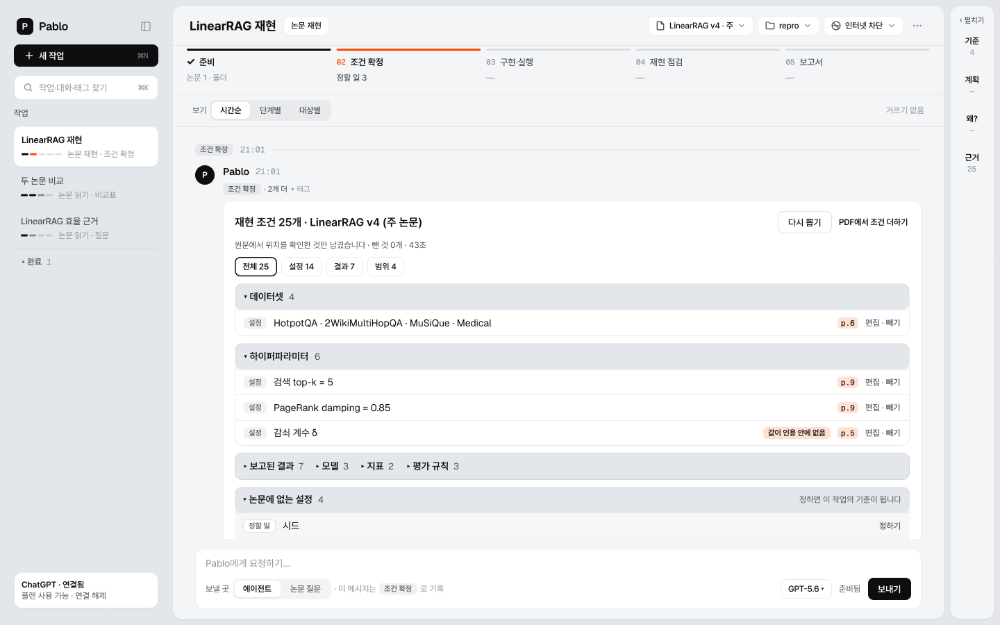
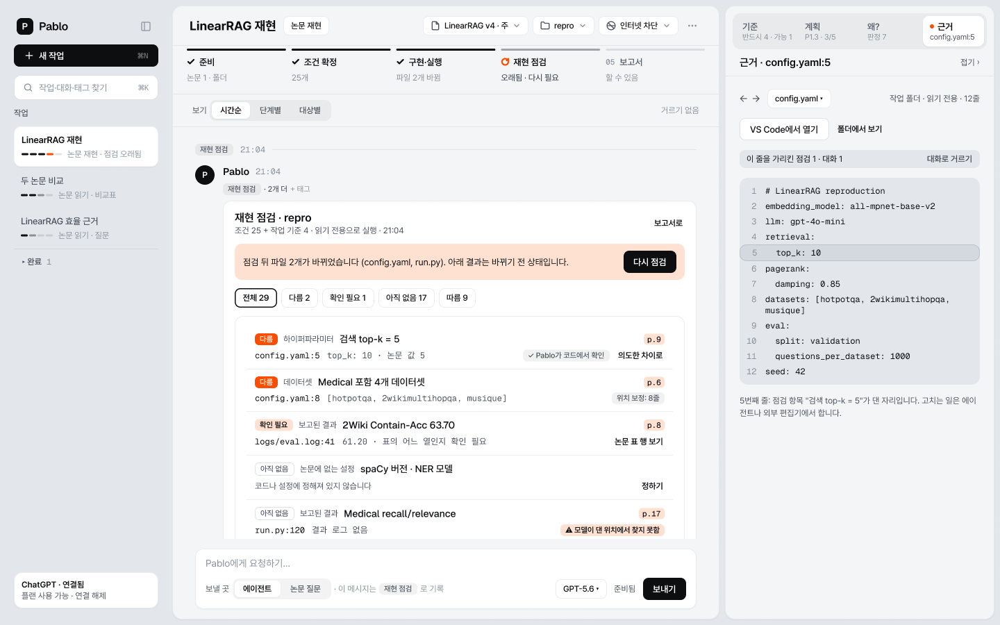
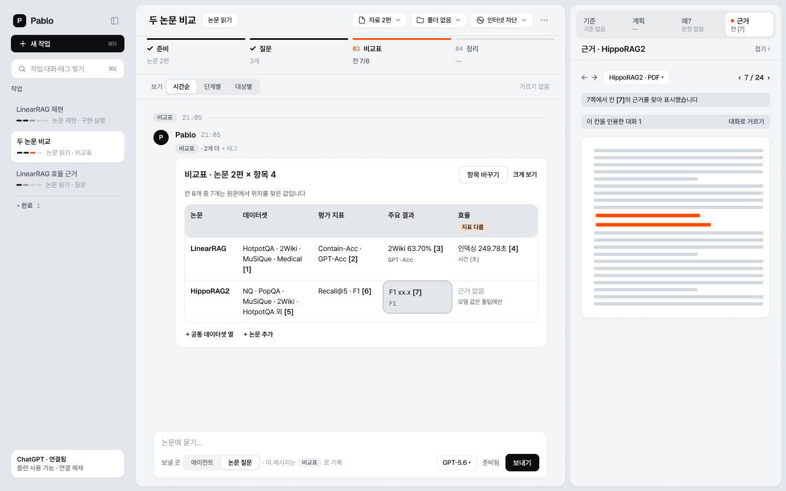
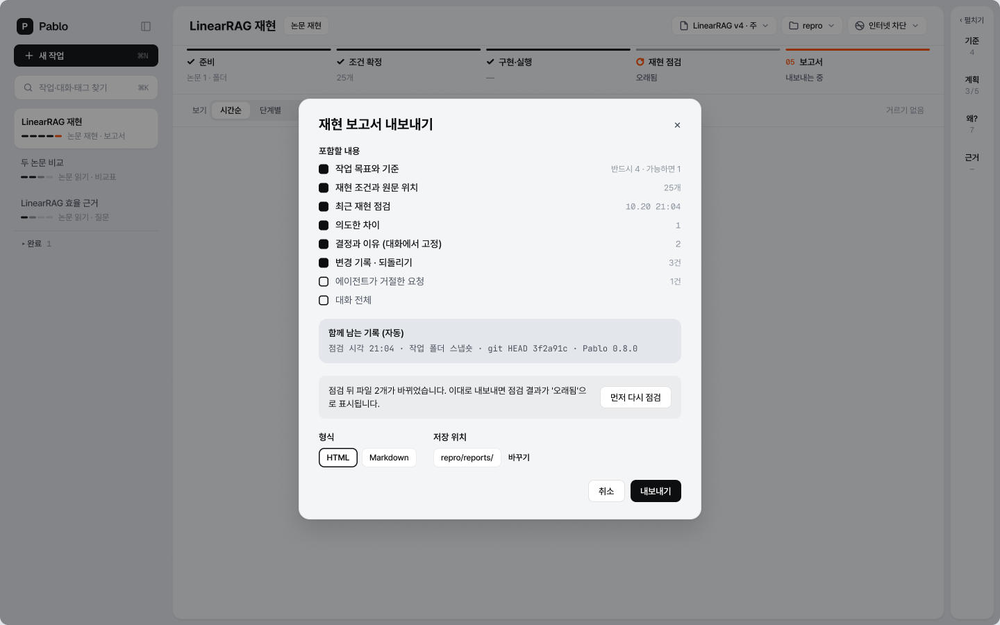
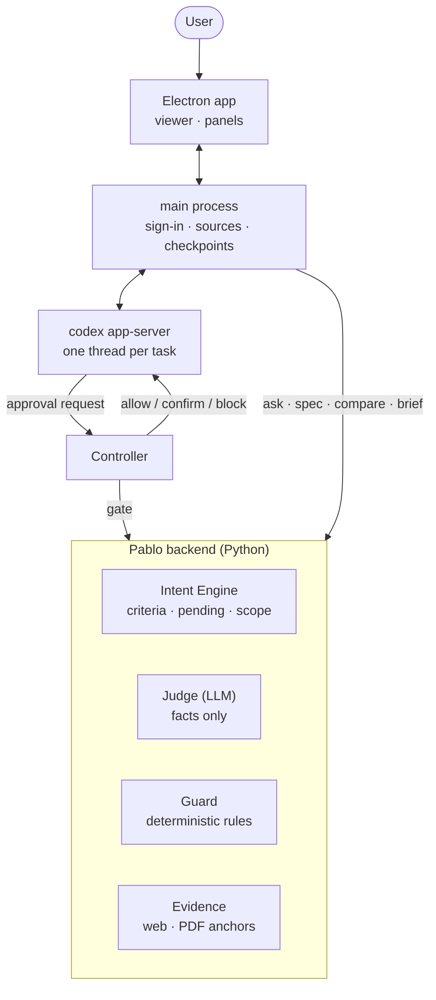

<div align="center">


# Pablo

**A research agent workbench that keeps to the criteria you set**

When you reproduce a paper, Pablo pins each condition to a page of the source and points to the file:line where the code drifts from it.<br/>
When the agent tries something that conflicts with your criteria, Pablo stops it before it runs.

[](https://github.com/PabloITMST/Pablo_application/actions/workflows/test.yml)


[한국어](README.md) · **English**

</div>

<p align="center">
  
</p>

> The app UI is currently in Korean. Button names below give the Korean label in parentheses.

---

## Contents

- [Why Pablo](#why-pablo)
- [Features](#features)
- [How it works](#how-it-works)
- [Install](#install)
- [Getting started](#getting-started)
- [Running from source](#running-from-source)
- [Testing](#testing)
- [Packaging](#packaging)
- [Repository layout](#repository-layout)
- [Evaluation](#evaluation)
- [Security and privacy](#security-and-privacy)
- [Known limitations](#known-limitations)
- [Documentation](#documentation)
- [License](#license)

## Why Pablo

If you follow an LLM agent's suggestions one small change at a time, you can end up somewhere quite different from where you meant to go, and then keep changing things without understanding how you got there. In research code, that drift turns into real mistakes:

- Evaluation data leaks into training or tuning, and the numbers look better than they should.
- Settings stated in the paper get changed without a reason.
- Reported numbers come from somewhere other than the run logs.

Pablo is a Windows desktop app that runs the Codex agent with your ChatGPT account. It adds three things on top of the agent:

| | What it does |
|---|---|
| **Pins your intent** | Criteria you state in conversation are recorded as *must* or *should*. Vague remarks are held until a person decides. |
| **Judges every action** | Every write action the agent proposes goes through Guard, which returns *allow*, *needs confirmation*, or *block*. |
| **Ties evidence to the source** | A citation is kept only if Pablo can locate it in the source. Citations it cannot find are dropped from the answer. |

## Features

> The screens below are the final Figma design (A2). Details may differ from the shipping app.

### Criteria from conversation, and stages

A sentence with a lasting marker, such as "never use the test set for tuning", becomes a task criterion. A vague one, such as "PyTorch might be a bit easier", gets an **[Add as criterion] / [Ignore]** prompt. Lines Pablo could not read as criteria are flagged, not silently dropped. A paper-reproduction task starts with three *must* criteria already in place: keep evaluation data separate, keep the paper's settings, and take results only from actual runs.

Each task shows its progress on a stage bar (for reproduction: prepare → fix conditions → implement and run → audit → report). Stages are not enforced in order; they are computed from the record.

### Guard: stop it before it runs



- **Allow** runs silently. **Needs confirmation** shows exactly what would change (a diff or the command) and waits for [Proceed] / [Cancel]. **Block** refuses with a reason and changes nothing.
- The **Why?** panel replays the decision: the request, the criteria that applied, the source evidence, the plan step, the verdict, and the user's decision.
- For turns with a work folder, Pablo snapshots the folder before and after with a shadow git. Use **View changes** to see what changed and **Revert** to undo it. Your own `.git` is never touched.
- Internet access is per task and off by default. Even when it is on, every command still goes through Guard.

### Paper questions with source evidence



- Attach PDFs, arXiv IDs or links, OpenReview, DOIs, or web pages. A task can hold several papers.
- Click a citation [n] to open that page of that paper with the quoted sentence or table row highlighted.
- When an answer cites both a quantitative claim and a table value, it compares the two and says if they disagree.

### Reproduction conditions



- Pablo extracts datasets, splits, preprocessing, models, hyperparameters, training, metrics, baselines, reported results, and evaluation rules from the paper, each with its page. It also reads the appendix after the references.
- Only conditions whose location Pablo confirms on that page are kept. Settings the paper does not state, such as the seed, are listed as *to decide*.
- You can add a condition by selecting a sentence in the PDF, or remove one with a reason. **◇ Intended difference** records why you deliberately depart from the paper. Re-extracting keeps every change you made.
- These conditions are passed to the agent as evidence, and Guard blocks actions that contradict them.

### Reproduction audit: where the code departs from the paper



- The agent reads the code, configs, and run logs and judges each condition as **follows / differs / not yet / can't tell**. This turn runs in a read-only sandbox.
- **Pablo checks the verdicts itself.** It opens the file:line the model cited and looks for the value there. Found: "confirmed by Pablo in code". A few lines away: "location corrected". Not found: a warning.
- Click a file:line to highlight it in the code panel, or **Open in VS Code**.
- If files change after the audit, the card marks itself as stale.

### Comparison table and report

| Comparison table | Reproduction report |
|---|---|
|  |  |
| Each paper is read separately against the same columns (datasets, metrics, main results, efficiency, limitations) and placed side by side. Every cell carries a source page; cells Pablo cannot locate are left as "no evidence". | Saves the reproduction as a report: each condition with its paper page, intended differences and the reasons for removed conditions, the last audit and changes since, plus the audit time, folder snapshot, and git HEAD. |

## How it works



- **The model reports facts; rules decide.** The judge only answers factual questions such as "which criteria does this action touch". Allow, confirm, or block is decided by Guard's deterministic rules.
- **Evidence is verified by location.** Pablo re-finds every quote the model picks in the source (a web capture or the PDF's page text) and rejects it if it is missing or ambiguous. If the source changes, the evidence becomes `STALE`.
- **Tokens stay in the main process.** The renderer only receives the connection state. The app starts Codex with its own `CODEX_HOME` and never uses your `codex login` or `config.toml`.

The same engine is also available as a CLI (`python pablo.py ...`) and as a skill for other agents ([`.claude/skills/pablo/SKILL.md`](.claude/skills/pablo/SKILL.md)).

## Install

### Requirements

- Windows 10/11 x64 with 2 GB of free disk space
- An internet connection and a ChatGPT account
- (Optional) git, needed only for reverting changes
- (Recommended) PowerShell 7, needed to read code with non-ASCII text (such as Korean comments) correctly

  ```powershell
  winget install Microsoft.PowerShell
  ```

You do not need Python, Node.js, or the Codex CLI. The installer bundles them.

### Steps

1. Download `PabloSetup.exe` from [Releases](https://github.com/PabloITMST/Pablo_application/releases).
2. Verify the hash. The SHA-256 for 0.8.0 is `95f1f5398936fe9d54e0a1fc7766d28f577a1089a1d6d5bf53c37dc4dad6999c`.

   ```powershell
   Get-FileHash .\PabloSetup.exe -Algorithm SHA256
   ```

3. Run `PabloSetup.exe`. The installer is not code-signed, so if "Windows protected your PC" appears, click **More info → Run anyway**.
4. It installs for the current user without admin rights and opens Pablo when done.

| Path | Contents |
|---|---|
| `%LOCALAPPDATA%\Pablo\app-<version>` | The app (used read-only) |
| `%APPDATA%\pablo-desktop` | User data: sign-in, task records, conversations, checkpoints |

Upgrading from an earlier version keeps your tasks, conversations, and sign-in.

## Getting started

1. Click **Continue with ChatGPT** (ChatGPT로 계속하기) and approve in your system browser.
2. In **+ New task** (+ 새 작업), write the goal and your criteria. For a reproduction, choose **Paper reproduction task** (논문 재현 작업).
3. Pick sources (PDF, arXiv, DOI) and a work folder in the header.
4. **Extract conditions** (재현 조건 뽑기) → ask the agent → **Audit** (재현 점검) → click a file:line to check the code.
5. Save the record with **Report** (보고서).

An 18-minute demo script is in [`release/0.8.0/DEMO_SCENARIO.md`](release/0.8.0/DEMO_SCENARIO.md) (in Korean). It uses [`release/0.7.0/demo-repro/`](release/0.7.0/demo-repro/), a folder that departs from the paper on purpose.

## Running from source

Development environment: Windows, Python 3.11, Node.js LTS, git

```bash
git clone https://github.com/PabloITMST/Pablo_application.git
cd Pablo_application
pip install -r requirements.txt
npm --prefix desktop install
npm --prefix desktop start
```

`requirements.txt` pins only `pypdf==6.19.0`. With any other version Pablo refuses to extract PDF text, because anchor positions can shift between versions. In development the app calls the backend as `python -m pablo_v2`.

To use the CLI alone, run it from the repository root:

```bash
python pablo.py login                                  # Codex (ChatGPT) browser sign-in
python pablo.py say "Never use evaluation data for training"   # record a criterion (held if vague)
python pablo.py task "Reproduce the LinearRAG baseline"        # task T1
python pablo.py act T1 "Add data/test.jsonl to the training data"   # ALLOW | WARN | BLOCK
python pablo.py source paper.pdf                       # source SRC1
python pablo.py ask T1 "What supports the efficiency claim?" --source SRC1
```

The full command list and state file formats are in the [developer reference](docs/reference.md) (in Korean).

## Testing

```bash
# Test paper (not committed; arXiv serves the same bytes)
curl -sSL -o LinearRAG.pdf https://arxiv.org/pdf/2510.10114v4
echo "1df0bd67b590f331d7928c65bbdc0a086ce6c41195428a8f3670683dcd3de533  LinearRAG.pdf" | sha256sum -c

# Python tests (the same loop as GitHub Actions)
for t in tests/*/test_*.py; do python "$t" || break; done

# App UI checks (offline)
npm --prefix desktop run check -- --ui

# Both of the above in order: local CI for when Actions is unavailable
npm --prefix desktop run ci
```

| Check | Account | What it covers |
|---|---|---|
| `tests/*/test_*.py` | Not needed | Criteria extraction and policy, Guard rules, anchors, PDF, UI script syntax |
| `check -- --ui` | Not needed | Conversation order, diff cards, checkpoints and revert, audit table → code panel, comparison table, source import |
| `check -- --auth`, `--pdf` | Not needed | Sign-in flow against a fake OAuth server; page and highlight for 19 PDF evidence items |
| `check -- --guard`, `--agent`, `--spec`, `--audit` | Real account | Agent runs, Guard verdicts, condition extraction, reproduction audit (several minutes) |
| `desktop/rc.js <Pablo.exe>` | Real account | The packaged app end to end, with an empty PATH and fresh userData |

Do not run two real-account checks at the same time. If both refresh the same token, the stored sign-in can be erased.

## Packaging

Builds the Windows x64 installer. Create the build venv once:

```bash
python -m venv build/venv
build/venv/Scripts/python -m pip install -r requirements-build.txt

npm --prefix desktop run backend   # PyInstaller onedir → build/dist/pablo-backend
npm --prefix desktop run make      # → desktop/out/make/squirrel.windows/x64/PabloSetup.exe
```

The installed app runs only the backend in `resources/` and a pinned Codex (`@openai/codex@0.152.0-win32-x64`). It never uses the system Python, a `codex` on PATH, or the repository, and writes only to userData.

## Repository layout

```text
Pablo_application/
├── pablo.py                 # CLI entry point
├── src/pablo_v2/
│   ├── intent/              # Intent Engine: criteria extraction, pending/commit policy, scope
│   └── skill/               # judge, Guard, evidence anchors, PDF, viewer, report
├── desktop/                 # Electron app
│   ├── main.js              # windows, sources, file reads, checkpoint wiring
│   ├── agent.js             # codex app-server (one thread per task)
│   ├── controller.js        # approval request → Guard → allow/confirm/block
│   ├── siwc.js              # Sign in with ChatGPT (PKCE, encrypted token storage)
│   ├── checkpoint.js        # shadow git checkpoints and revert
│   ├── papers.js, where.js  # multiple papers, audit file:line verification
│   └── check.js, rc.js      # app checks, installer checks
├── tests/                   # intent · skill · eval (gold sets and benchmarks)
├── docs/                    # developer reference, plans, evaluation records, images
├── release/<version>/       # release notes, known limitations, demo script, clean-machine checklist
└── assets/character/        # mascot and app icon sources
```

## Evaluation

Methods, raw results, and how to rerun them are in [`docs/eval/README.md`](docs/eval/README.md) (in Korean).

| Item | Result |
|---|---|
| Audit: 12 unseen planted deviations | Pablo reported 11/12; asking the same model directly found 10/12 |
| Audit: amount to read | Pablo 50 findings, asking directly 119 |
| Condition extraction: three other papers, 90 human-checked gold conditions | Recall 43–73% |
| PDF evidence: 19 LinearRAG gold items | Page and highlight checks pass offline |

Detection is on par with simply asking the model. Where Pablo does better is the shape of the answer: less than half as much to read, a source page on every verdict, and file:line locations that Pablo confirms itself.

## Security and privacy

- **Sign-in:** Uses Sign in with ChatGPT (PKCE, state, nonce, ID token verification). Tokens are encrypted with Windows DPAPI in `credentials.bin`. Disconnecting revokes the refresh token and deletes local credentials.
- **Agent permissions:** The agent can write only inside the task's work folder, and every approval request goes through Guard. Requests for anything outside the work folder are refused without reaching Guard. The Pablo repository and its parent folders are never accepted as a work folder.
- **Network:** The agent's sandbox has networking off by default. You can turn it on per task.
- **External services:** Paper import (arXiv, OpenReview, Crossref) sends the ID or search terms you enter to that service. The app shows what it sent and where.
- **File reads:** The code panel opens only text files of 1 MB or less inside the task's folder, after following links.

## Known limitations

- The installer is not code-signed and there are no automatic updates. Windows x64 only.
- Choosing reproduction conditions and judging the audit are done by the model. Pablo confirms locations and values but does not re-check the verdict itself.
- Condition extraction reads the appendix and is slow: about 3–4 minutes for LinearRAG.
- Table numbers may be paired with the wrong column, so they show "? check column pairing" until confirmed.
- Long training runs are best run outside the app.

Full list: [`release/0.8.0/KNOWN_LIMITATIONS.md`](release/0.8.0/KNOWN_LIMITATIONS.md) (in Korean)

## Documentation

All documents below are in Korean.

| Document | Contents |
|---|---|
| [Developer reference](docs/reference.md) | CLI commands, state files, app check scenarios, design decisions by milestone |
| [Release 0.8.0](release/0.8.0/README.md) | What changed, verification results, install |
| [Demo script](release/0.8.0/DEMO_SCENARIO.md) | 18-minute demo steps and talking points |
| [Clean-machine checklist](release/0.8.0/CLEAN_MACHINE_TEST.md) | Verifying the installer on a PC without dev tools |
| [Evaluation](docs/eval/README.md) | Quantitative evaluation of audit and condition extraction |
| [Pablo skill](.claude/skills/pablo/SKILL.md) | How another agent calls Pablo |
| [UI plan](docs/plan-ui-a2.md) | Plan for applying the final design (A2) |

## License

The repository does not have a license file yet. Notices for the bundled third-party components (Electron, Codex, pdf.js, pypdf, and others) are in [`desktop/THIRD_PARTY_NOTICES.txt`](desktop/THIRD_PARTY_NOTICES.txt).

Pablo is an independent project and is not affiliated with OpenAI. ChatGPT and Codex are trademarks of OpenAI.
