<div align="center">


# Pablo

**처음 정한 기준을 지키는 연구 에이전트 작업대**

논문을 재현할 때 조건은 원문 쪽에 고정하고, 코드가 그 조건에서 벗어난 곳은 파일:줄로 짚습니다.<br/>
에이전트가 기준과 부딪히는 작업을 하려 하면 실행 전에 막습니다.

[](https://github.com/PabloITMST/Pablo_application/actions/workflows/test.yml)


**한국어** · [English](README.en.md)

</div>

<p align="center">
  
</p>

---

## 목차

- [왜 Pablo인가](#왜-pablo인가)
- [주요 기능](#주요-기능)
- [작동 방식](#작동-방식)
- [설치](#설치)
- [처음 쓰기](#처음-쓰기)
- [소스에서 실행하기](#소스에서-실행하기)
- [테스트](#테스트)
- [패키징](#패키징)
- [저장소 구조](#저장소-구조)
- [평가](#평가)
- [보안과 개인정보](#보안과-개인정보)
- [알려진 제한](#알려진-제한)
- [문서](#문서)
- [라이선스](#라이선스)

## 왜 Pablo인가

LLM 에이전트가 추천하는 대로 조금씩 고치다 보면 처음 생각과 다른 결과물이 나옵니다. 왜 그렇게 됐는지 모르는 채로 다시 고치게 됩니다. 연구 코드에서는 이런 어긋남이 실제 사고로 이어집니다.

- 평가 데이터가 학습이나 튜닝에 섞여 성능이 좋게 나옵니다.
- 논문에 적힌 설정값이 근거 없이 바뀝니다.
- 결과 수치를 실행 로그가 아닌 곳에서 가져옵니다.

Pablo는 ChatGPT 계정으로 Codex 에이전트를 쓰는 Windows 데스크톱 앱입니다. 에이전트 위에 세 가지를 얹습니다.

| | 하는 일 |
|---|---|
| **의도를 고정합니다** | 대화에서 말한 기준을 "반드시 / 가능하면"으로 기록합니다. 애매한 말은 사람이 정할 때까지 보류합니다. |
| **행동을 판정합니다** | 에이전트의 쓰기 행동은 모두 Guard를 거칩니다. 판정은 허용, 확인 필요, 막음 셋 중 하나입니다. |
| **근거를 원문에 묶습니다** | 인용은 Pablo가 원문에서 위치를 찾은 것만 남습니다. 못 찾은 인용은 답에서 뺍니다. |

## 주요 기능

> 아래 화면은 Figma의 최종 디자인(A2)입니다. 실제 앱과 세부가 다를 수 있습니다.

### 대화 속 기준과 단계

"test 셋은 튜닝에 절대 쓰지 마"처럼 지속 표시가 있는 문장은 작업 기준이 됩니다. "PyTorch가 좀 편할 것 같긴 한데"처럼 애매한 말은 **[기준으로 추가] / [무시]** 를 물어봅니다. 기준으로 읽지 못한 줄도 조용히 버리지 않고 알려 줍니다. 논문 재현 작업은 세 기준을 처음부터 "반드시"로 깔고 시작합니다. 평가 데이터 분리, 논문 설정 유지, 결과는 실행에서만 가져오기입니다.

작업은 단계 막대(논문 재현은 준비 → 조건 확정 → 구현·실행 → 재현 점검 → 보고서)로 진행 상황을 보여 줍니다. 단계는 순서를 강제하지 않고, 기록에서 계산합니다.

### Guard: 실행 전에 막기


- **허용**은 조용히 실행합니다. **확인 필요**는 바뀌는 내용(diff 또는 명령)을 보여 주고 [진행] / [취소]를 기다립니다. **막음**은 이유와 함께 거절하고 아무것도 바꾸지 않습니다.
- **왜?** 패널에서 판단 과정을 다시 볼 수 있습니다. 사용자 요청, 적용된 기준, 원문 근거, 계획 단계, 판정, 사용자 결정 순서입니다.
- 작업 폴더가 있는 턴은 앞뒤를 shadow git으로 남깁니다. 바뀐 파일은 **변경 보기**로 보고 **되돌리기**로 되돌립니다. 사용자의 `.git`은 건드리지 않습니다.
- 인터넷은 작업마다 따로 켭니다(기본 차단). 켜도 명령은 하나하나 Guard를 거칩니다.

### 논문 질문과 원문 근거


- PDF, arXiv 번호·링크, OpenReview, DOI, 웹 페이지를 자료로 붙입니다. 한 작업에 여러 편을 둘 수 있습니다.
- 답의 [n]을 누르면 그 논문의 그 쪽이 열리고 인용 문장이나 표의 한 행이 칠해집니다. 그 쪽에서 문장을 그대로 찾지 못하면 비슷한 문장 후보와 추출 텍스트를 보여 줍니다.
- 정량 주장과 표 수치를 함께 인용하면 답이 둘을 대조하고 어긋남을 밝힙니다.

### 재현 조건


- 논문에서 데이터셋, 분할, 전처리, 모델, 하이퍼파라미터, 학습, 지표, 비교 대상, 보고된 결과, 평가 규칙을 원문 쪽과 함께 뽑습니다. 참고문헌 뒤의 부록도 읽습니다.
- Pablo가 그 쪽에서 위치를 확인한 조건만 남깁니다. 시드처럼 논문에 없는 설정은 "정할 일"로 남깁니다.
- 사람이 PDF에서 문장을 골라 조건을 더하거나, 이유를 적고 뺄 수 있습니다. **◇ 의도한 차이**는 논문과 일부러 다르게 하는 이유를 남깁니다. 다시 뽑아도 사람이 고친 것은 그대로입니다.
- 이 조건은 에이전트에게 근거로 전달되고, Guard는 조건과 모순되는 행동을 막습니다.

### 재현 점검: 코드가 논문에서 벗어난 곳


- 에이전트가 코드, 설정, 실행 로그를 읽고 조건마다 **따름 / 다름 / 아직 없음 / 판단 못 함**을 판정합니다. 이 턴은 읽기 전용 샌드박스에서 돕니다.
- **Pablo가 판정을 직접 확인합니다.** 모델이 댄 파일:줄을 열어 그 값이 있는지 봅니다. 있으면 "Pablo가 코드에서 확인", 몇 줄 옆이면 "위치 보정", 없으면 경고를 붙입니다.
- 파일:줄을 누르면 코드 패널이 그 줄을 강조합니다. **VS Code에서 열기**도 됩니다.
- 점검 뒤에 파일이 바뀌면 카드가 "오래됨"을 알립니다.

### 비교표와 보고서

| 비교표 | 재현 보고서 |
|---|---|
|  |  |
| 논문마다 같은 항목(데이터셋, 지표, 주요 결과, 효율, 한계)을 따로 읽어 나란히 놓습니다. 칸마다 원문 쪽이 붙고, 위치를 못 찾은 칸은 "근거 없음"으로 비웁니다. | 재현 작업을 보고서로 저장합니다. 조건마다 논문 쪽, 의도한 차이와 뺀 이유, 마지막 점검과 그 뒤의 변경, 점검 시각·폴더 스냅숏·git HEAD가 들어갑니다. |

## 작동 방식

```mermaid
flowchart TD
  user([사용자]) --> ui["Electron 앱<br/>viewer · 패널"]
  ui <--> main["main process<br/>로그인 · 자료 · 체크포인트"]
  main <--> agent["codex app-server<br/>작업마다 thread"]
  agent -- "승인 요청" --> ctrl["Controller"]
  ctrl -- "gate" --> backend
  subgraph backend["Pablo backend (Python)"]
    intent["Intent Engine<br/>기준 · 보류 · 범위"]
    judge["Judge (LLM)<br/>사실만 판정"]
    guard["Guard<br/>결정적 규칙"]
    evidence["Evidence<br/>원문 · PDF 앵커"]
  end
  ctrl -- "허용 / 확인 / 막음" --> agent
  main -- "ask · spec · compare · brief" --> backend
```



- **모델은 사실을 보고, 판정은 규칙이 냅니다.** judge는 "이 행동이 어떤 기준과 관련 있는가" 같은 사실만 답하고, 허용·확인·막음은 Guard의 결정적 규칙이 정합니다.
- **근거는 위치로 확인합니다.** 모델이 고른 인용은 Pablo가 원문(웹 캡처 또는 PDF 쪽 텍스트)에서 다시 찾습니다. 못 찾거나 여러 곳에서 찾으면 거절합니다. 원문이 바뀌면 근거는 `STALE`이 됩니다.
- **토큰은 main process에만 있습니다.** 화면(renderer)은 연결 상태만 받습니다. 앱은 Pablo 전용 `CODEX_HOME`으로 Codex를 띄우고, 사용자의 `codex login`이나 `config.toml`을 쓰지 않습니다.

같은 엔진을 CLI(`python pablo.py ...`)와 다른 에이전트용 스킬([`.claude/skills/pablo/SKILL.md`](.claude/skills/pablo/SKILL.md))로도 씁니다.

## 설치

### 필요한 것

- Windows 10/11 x64, 디스크 여유 2 GB
- 인터넷 연결과 ChatGPT 계정
- (선택) git: 변경 되돌리기에만 필요합니다.
- (권장) PowerShell 7: 한글이 든 코드를 정확히 읽는 데 필요합니다.

  ```powershell
  winget install Microsoft.PowerShell
  ```

Python, Node.js, Codex CLI는 필요 없습니다. 설치본에 들어 있습니다.

### 설치 순서

1. [Releases](https://github.com/PabloITMST/Pablo_application/releases)에서 `PabloSetup.exe`를 받습니다.
2. 해시를 확인합니다. 0.9.0의 SHA-256은 `017c698d88b9b2d2088d491adc16187895fc6955b7e380e8b369c329a55d3a67`입니다.

   ```powershell
   Get-FileHash .\PabloSetup.exe -Algorithm SHA256
   ```

3. `PabloSetup.exe`를 실행합니다. 설치 파일에 코드 서명이 없어서 "Windows의 PC 보호" 창이 뜨면 **추가 정보 → 실행**을 누릅니다.
4. 관리자 권한 없이 현재 사용자에게만 설치되고, 끝나면 Pablo가 열립니다.

| 경로 | 내용 |
|---|---|
| `%LOCALAPPDATA%\Pablo\app-<버전>` | 앱 (읽기 전용으로 씁니다) |
| `%APPDATA%\pablo-desktop` | 사용자 데이터: 로그인 정보, 작업 기록, 대화, 체크포인트 |

이전 버전에서 올리면 작업, 대화, 로그인이 그대로 이어집니다.

## 처음 쓰기

1. 사이드바 아래 계정 카드의 **ChatGPT로 연결**을 누르고 시스템 브라우저에서 승인합니다. 연결 해제와 플랜 다시 확인은 **설정 · 계정**에 있습니다.
2. **+ 새 작업**(Ctrl N) 대화상자에서 목표와 기준을 적습니다. 종류는 **논문 재현**, **논문 읽기**, **일반** 중에서 고르고, 종류마다 단계가 다릅니다. 자료(PDF, arXiv, OpenReview, DOI), 작업 폴더, 인터넷도 여기서 정합니다. arXiv 논문은 받기 전에 파일 이름 · 출처 · 크기를 보여 줍니다.
3. 나중에 바꿀 때는 머리줄의 **자료 · 폴더 · 인터넷** 칩을 누릅니다.
4. **재현 조건 뽑기** → 에이전트에게 요청 → **재현 점검** → 파일:줄을 눌러 코드를 확인합니다.
5. 머리줄 **⋯** 메뉴나 단계 막대의 **보고서 내보내기**로 재현 기록을 HTML이나 Markdown으로 저장합니다.

18분짜리 시연 순서는 [`release/0.8.0/DEMO_SCENARIO.md`](release/0.8.0/DEMO_SCENARIO.md)에 있습니다. 0.9.0에서 버튼 자리가 바뀐 곳은 [릴리스 0.9.0](release/0.9.0/README.md)의 "0.8.0 문서를 0.9.0에서 따라 할 때" 표를 봅니다. 일부러 논문과 다르게 만든 시연 폴더 [`release/0.7.0/demo-repro/`](release/0.7.0/demo-repro/)를 씁니다.

## 소스에서 실행하기

개발 환경: Windows, Python 3.11, Node.js LTS, git

```bash
git clone https://github.com/PabloITMST/Pablo_application.git
cd Pablo_application
pip install -r requirements.txt
npm --prefix desktop install
npm --prefix desktop start
```

`requirements.txt`는 `pypdf==6.19.0` 하나입니다. 다른 버전이면 PDF 텍스트 추출을 거부합니다(앵커 위치가 버전마다 달라질 수 있어서입니다). 개발 모드의 앱은 `python -m pablo_v2`로 백엔드를 부릅니다.

CLI만 쓸 때는 저장소 루트에서 실행합니다.

```bash
python pablo.py login                                  # Codex(ChatGPT) 브라우저 로그인
python pablo.py say "평가 데이터는 절대 학습에 쓰지 마"      # 기준 기록 (애매하면 보류)
python pablo.py task "LinearRAG baseline 재현"            # 작업 T1
python pablo.py act T1 "data/test.jsonl을 학습 데이터에 추가"   # ALLOW | WARN | BLOCK
python pablo.py source paper.pdf                       # 자료 SRC1
python pablo.py ask T1 "효율 주장의 근거는?" --source SRC1
```

명령 전체와 상태 파일 형식은 [개발 참고서](docs/reference.md)에 있습니다.

## 테스트

```bash
# 테스트용 논문 (저장소에 넣지 않습니다. arXiv가 같은 파일을 줍니다)
curl -sSL -o LinearRAG.pdf https://arxiv.org/pdf/2510.10114v4
echo "1df0bd67b590f331d7928c65bbdc0a086ce6c41195428a8f3670683dcd3de533  LinearRAG.pdf" | sha256sum -c

# Python 테스트 (GitHub Actions와 같은 루프)
for t in tests/*/test_*.py; do python "$t" || break; done

# 앱 화면 점검 (오프라인)
npm --prefix desktop run check -- --ui

# 위 둘과 연결 화면 점검(--auth, 가짜 로그인 서버)을 차례로: Actions를 못 쓸 때의 로컬 CI
npm --prefix desktop run ci
```

| 점검 | 계정 | 확인하는 것 |
|---|---|---|
| `tests/*/test_*.py` | 필요 없음 | 기준 추출·정책, Guard 규칙, 앵커, PDF, 화면 스크립트 문법 |
| `check -- --ui` | 필요 없음 | 대화 순서, diff 카드, 체크포인트·되돌리기, 점검표 → 코드 패널, 비교표, 자료 가져오기 |
| `check -- --auth`, `--pdf` | 필요 없음 | 가짜 OAuth 서버로 로그인 흐름, PDF 근거 19개의 쪽·하이라이트 |
| `check -- --guard`, `--agent`, `--spec`, `--audit` | 실제 계정 | 에이전트 실행, Guard 판정, 조건 뽑기, 재현 점검 (수 분) |
| `desktop/rc.js <Pablo.exe>` | 실제 계정 | 패키징한 앱을 빈 PATH·새 userData로 끝까지 |

실제 계정 점검을 둘 이상 동시에 돌리지 마세요. 같은 refresh token을 둘이 갱신하면 로그인 정보가 지워질 수 있습니다.

## 패키징

Windows x64 설치 파일을 만듭니다. build venv는 한 번만 만듭니다.

```bash
python -m venv build/venv
build/venv/Scripts/python -m pip install -r requirements-build.txt

npm --prefix desktop run backend   # PyInstaller onedir → build/dist/pablo-backend
npm --prefix desktop run make      # → desktop/out/make/squirrel.windows/x64/PabloSetup.exe
```

설치본은 `resources/`의 백엔드와 고정한 Codex(`@openai/codex@0.152.0-win32-x64`)만 실행합니다. 시스템 Python, PATH의 codex, 저장소는 쓰지 않습니다. 쓰기는 userData에만 합니다.

## 저장소 구조

```text
Pablo_application/
├── pablo.py                 # CLI 진입점
├── src/pablo_v2/
│   ├── intent/              # Intent Engine: 기준 추출, 보류·확정 정책, 범위
│   └── skill/               # judge, Guard, 근거 앵커, PDF, 화면(viewer), 보고서
├── desktop/                 # Electron 앱
│   ├── main.js              # 창, 자료, 파일 읽기, 체크포인트 연결
│   ├── agent.js             # codex app-server (작업마다 thread)
│   ├── controller.js        # 승인 요청 → Guard → 허용/확인/막음
│   ├── siwc.js              # Sign in with ChatGPT (PKCE, 토큰 암호화 저장)
│   ├── checkpoint.js        # shadow git 체크포인트·되돌리기
│   ├── papers.js, where.js  # 여러 논문, 점검 파일:줄 확인
│   └── check.js, rc.js      # 앱 점검, 설치본 점검
├── tests/                   # intent · skill · eval (정답 세트와 벤치)
├── docs/                    # 개발 참고서, 계획, 평가 기록, 이미지
├── release/<버전>/          # 릴리스 노트, 알려진 제한, 시연 시나리오, 깨끗한 PC 점검표
└── assets/character/        # 마스코트와 앱 아이콘 원본
```

## 평가

정량 평가의 방법, 원본, 다시 돌리는 법은 [`docs/eval/README.md`](docs/eval/README.md)에 있습니다.

| 항목 | 결과 |
|---|---|
| 재현 점검: 처음 보는 어긋남 12종 | Pablo 11/12 보고. 같은 모델에 그냥 물으면 10/12 |
| 재현 점검: 읽을 보고량 | Pablo 50건, 그냥 묻기 119건 |
| 조건 뽑기: 다른 논문 세 편, 사람이 확인한 정답 90개 | 재현율 43–73% |
| PDF 근거: LinearRAG 정답 19개 | 쪽·하이라이트 오프라인 점검 통과 |

탐지율은 그냥 묻는 것과 비슷합니다. Pablo가 나은 점은 답의 꼴입니다. 읽을 양이 절반 이하이고, 판정마다 원문 쪽이 붙고, Pablo가 파일:줄을 직접 확인합니다.

## 보안과 개인정보

- **로그인:** Sign in with ChatGPT(PKCE, state, nonce, ID token 검증)를 씁니다. 토큰은 Windows DPAPI로 암호화해 `credentials.bin`에 저장합니다. 연결 해제는 refresh token을 폐기하고 로컬 정보를 지웁니다.
- **에이전트 권한:** 대화는 작업 폴더 안에서만 쓸 수 있고, 모든 승인 요청이 Guard를 거칩니다. 작업 폴더 밖 권한 요청은 Guard 없이 거절합니다. Pablo 저장소나 그 상위 폴더는 작업 폴더로 받지 않습니다.
- **네트워크:** 에이전트의 샌드박스는 기본으로 네트워크가 꺼져 있습니다. 작업마다 켤 수 있습니다.
- **바깥 서비스:** 논문 가져오기(arXiv, OpenReview, Crossref)는 입력한 번호나 검색어를 그 서비스로 보냅니다. 앱은 무엇을 어디로 보냈는지 화면에 적습니다.
- **파일 읽기:** 코드 패널은 그 작업의 폴더 안(링크를 따라간 뒤에도), 텍스트, 1 MB 이하 파일만 엽니다.

## 알려진 제한

- 설치 파일에 코드 서명이 없고, 자동 업데이트가 없습니다. Windows x64 전용입니다.
- 재현 조건 고르기와 점검 판정은 모델이 합니다. Pablo는 위치와 값이 있는지 확인하지만, 판정 자체를 다시 확인하지는 않습니다.
- 조건 뽑기가 부록까지 읽어 느립니다. LinearRAG 기준 약 3–4분입니다.
- 표의 숫자는 열 짝이 틀릴 수 있어서, 확인 전에는 "? 열 짝 확인 필요"로 보입니다.
- 긴 학습 실행은 앱 밖에서 돌리는 것을 권합니다.

전체 목록: [`release/0.9.0/KNOWN_LIMITATIONS.md`](release/0.9.0/KNOWN_LIMITATIONS.md)

## 문서

| 문서 | 내용 |
|---|---|
| [개발 참고서](docs/reference.md) | CLI 명령, 상태 파일, 앱 점검 시나리오, 마일스톤별 설계 결정 |
| [릴리스 0.9.0](release/0.9.0/README.md) | 바뀐 것, 검증 결과, 설치, 0.8.0 문서와 버튼 위치 대응표 |
| [시연 시나리오](release/0.8.0/DEMO_SCENARIO.md) | 18분 시연 순서와 말할 것 (0.8.0 화면 기준) |
| [깨끗한 PC 점검표](release/0.8.0/CLEAN_MACHINE_TEST.md) | 개발 도구 없는 PC에서 설치본 확인 (0.8.0 화면 기준) |
| [평가](docs/eval/README.md) | 재현 점검·조건 뽑기 정량 평가 |
| [Pablo 스킬](.claude/skills/pablo/SKILL.md) | 다른 에이전트가 Pablo를 부르는 법 |
| [UI 계획](docs/plan-ui-a2.md) | 최종 디자인(A2) 적용 계획 |

## 라이선스

아직 저장소에 라이선스 파일이 없습니다. 함께 배포하는 서드파티 구성 요소(Electron, Codex, pdf.js, pypdf 등)의 고지는 [`desktop/THIRD_PARTY_NOTICES.txt`](desktop/THIRD_PARTY_NOTICES.txt)에 있습니다.

Pablo는 OpenAI와 제휴하지 않은 독립 프로젝트입니다. ChatGPT와 Codex는 OpenAI의 상표입니다.
