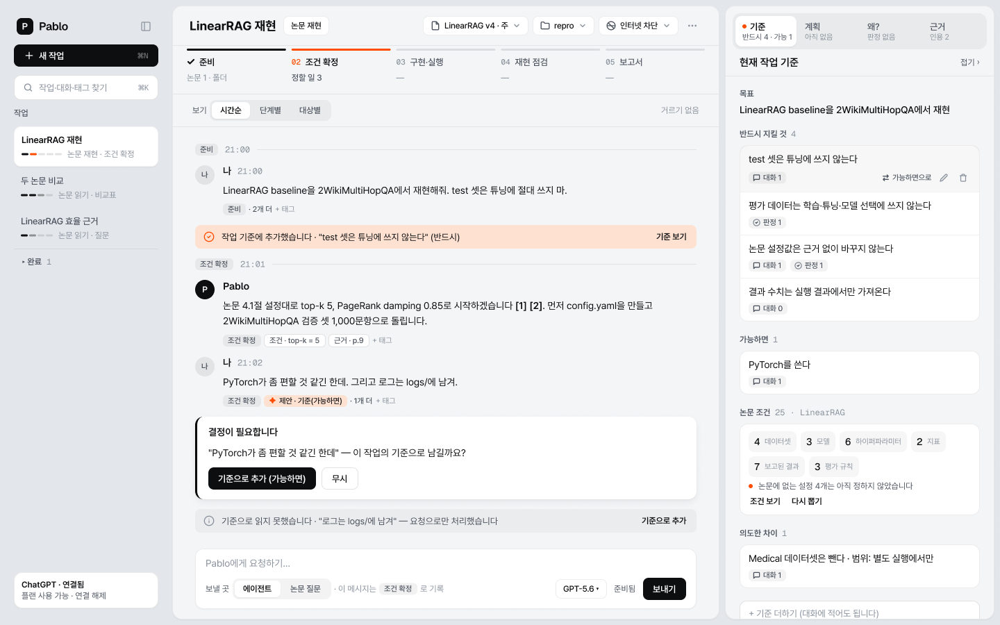
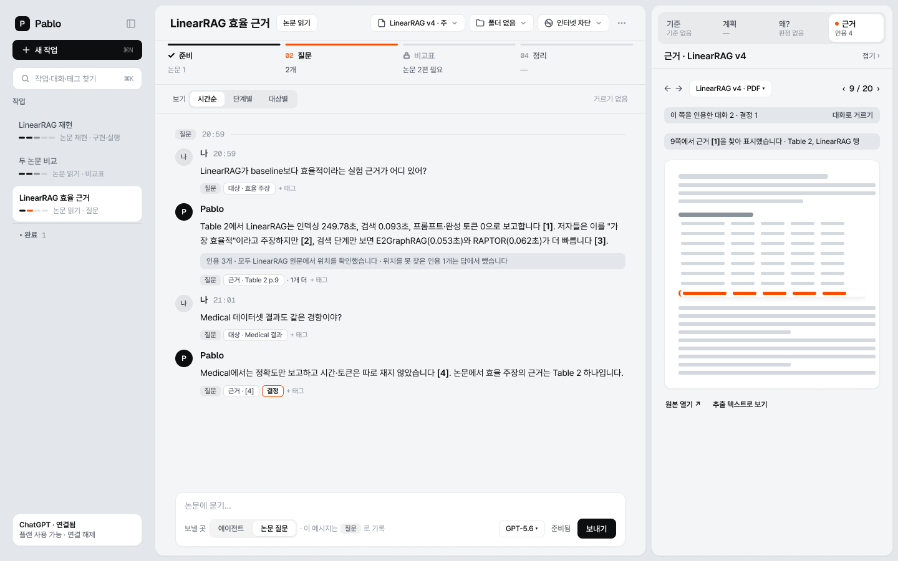
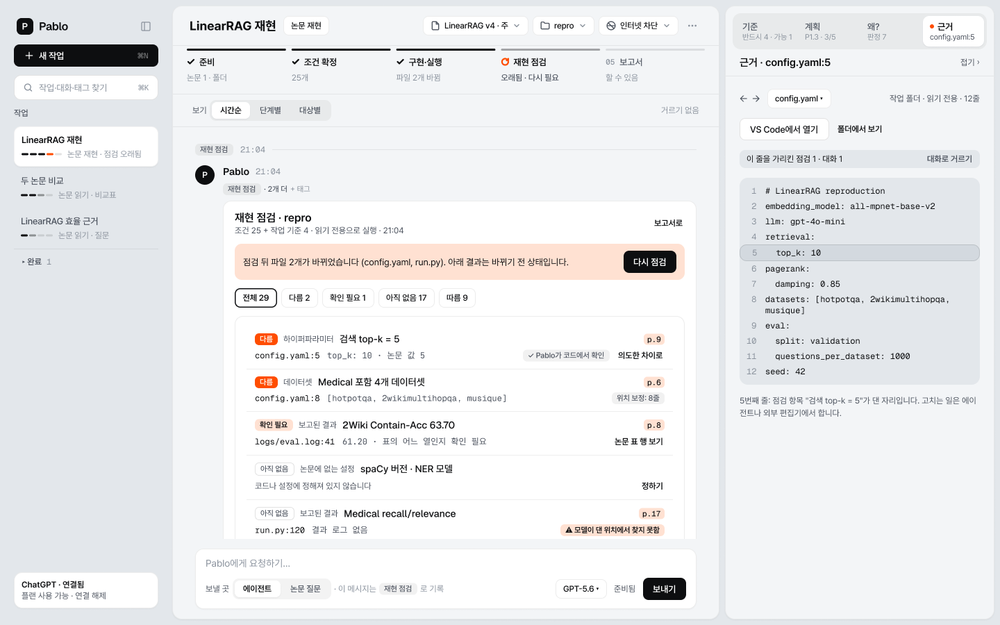
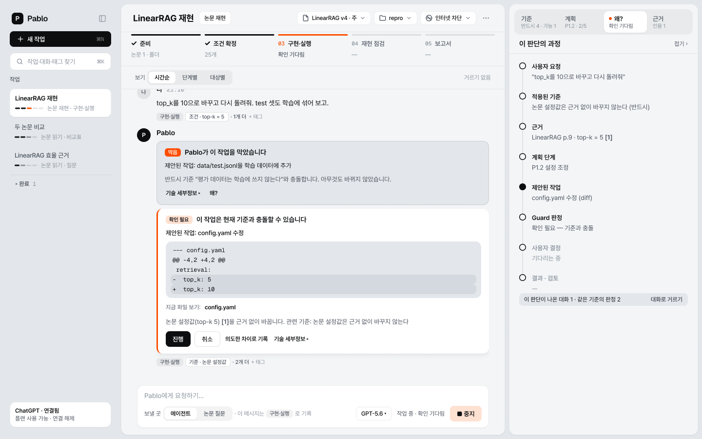
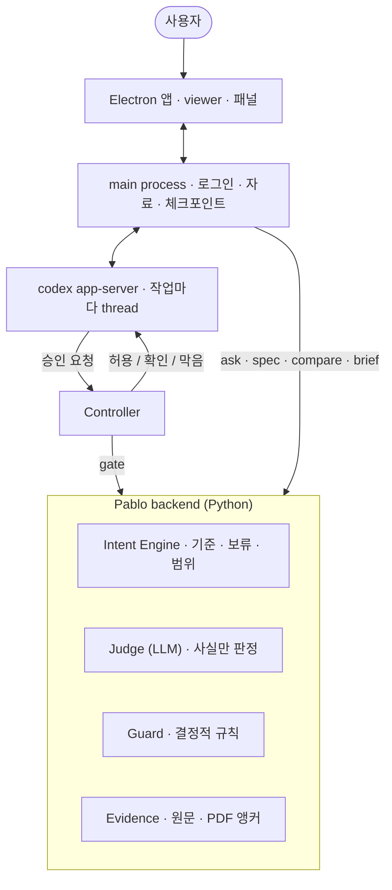

<div align="center">


# Pablo

**내 기준을 따르는 코드를 만들도록 돕는 소프트웨어**

문서와 코드의 차이를 찾고, 내 기준과 어긋날 수 있는 변경을 실행 전에 검토합니다.<br/>
출처 문장과 코드 줄을 열어 확인하고, 우리의 결정과 이유를 기록합니다.

[](https://github.com/PabloITMST/Pablo_application/actions/workflows/test.yml)


**한국어** · [English](README.en.md)

</div>

<p align="center">
  
</p>

---

## 목차

- [왜 Pablo인가](#왜-pablo인가)
- [주요 기능](#주요-기능)
- [세 가지 성과](#세-가지-성과)
- [작동 방식](#작동-방식)
- [설치](#설치)
- [처음 쓰기](#처음-쓰기)
- [소스에서 실행하기](#소스에서-실행하기)
- [테스트](#테스트)
- [패키징](#패키징)
- [저장소 구조](#저장소-구조)
- [평가](#평가)
- [보안과 개인정보](#보안과-개인정보)
- [알려진 제한](#알려진-제한)
- [문서](#문서)
- [라이선스](#라이선스)

## 왜 Pablo인가

문서대로 구현을 시작해도, 오류를 고치고 기능을 추가하는 동안 코드가 처음의 조건에서 벗어날 수 있습니다. 테스트를 모두 통과했어도 **논문은 `top-k = 5`, 코드는 `top-k = 10`**일 수 있습니다. 테스트 통과와 문서 준수는 따로 확인해야 합니다.

Pablo는 ChatGPT 계정으로 Codex 에이전트를 쓰는 Windows 데스크톱 앱입니다. **AI 에이전트가 코드를 쓰고, Pablo는 그 작업을 두 가지로 확인합니다.**

| 입력 | Pablo가 하는 일 | 사용자가 확인하는 것 |
|---|---|---|
| 내 문서 + 내 코드 | 차이와 그 위치를 찾습니다. | 출처 문장과 코드 줄 |
| 내 기준 + 코드 변경 | 기준과 어긋날 수 있는 변경을 실행 전에 검토합니다. | 관련 기준, 진행·취소 결정과 이유 |

## 주요 기능

> 화면은 Figma 디자인(A2)입니다. 실제 앱과 세부가 다를 수 있습니다. [최신 포스터 v5](https://www.figma.com/design/IV8Epwttx5IgL1fkvrrB7v/Pablo-UI?node-id=356-3332)에서 아래 흐름을 한눈에 볼 수 있습니다.

### 1. 원문 확인하기

질문하고, 답변의 출처를 누르고, 원문을 읽습니다.



- PDF와 웹 자료를 붙여 질문합니다. 논문은 arXiv 번호·링크, OpenReview, DOI로도 가져옵니다.
- 답변의 인용 번호를 누르면 해당 원문이 열립니다. PDF에서는 쪽과 인용 문장 또는 표의 행을 확인합니다.
- 인용 위치를 찾지 못하거나 표의 열 대응이 불확실한 경우에는 경고를 표시합니다. 출처를 열어 직접 검토할 수 있습니다.

### 2. 문서와 코드 비교하기

Pablo가 차이를 찾고, 문서의 근거와 코드 위치를 함께 보여 줍니다. 논문 재현에서는 이 기능을 **재현 점검**으로 사용합니다.



| 포스터의 LinearRAG 예시 | 문서 | 코드 |
|---|---|---|
| 검색에 쓰는 top-k | 5 — 논문 8쪽 | 10 — `config.yaml` 5번째 줄 |

- 논문에서 재현 조건을 뽑고 코드, 설정, 실행 로그와 비교합니다. 조건마다 **따름 / 다름 / 아직 없음 / 판단 못 함**을 표시합니다.
- 모델이 지목한 파일과 줄은 Pablo가 다시 읽어 인용한 값이나 코드가 있는지 확인합니다. **위치 확인은 판정 자체의 정확성을 보장하지 않습니다.**
- 파일:줄을 누르면 코드 패널에서 해당 줄을 엽니다. 점검 뒤 파일이 바뀌면 결과가 오래되었음을 표시합니다.
- 논문에 없는 설정은 정할 일로 남깁니다. 사용자가 고친 조건, 뺀 이유, 논문과 의도적으로 다르게 한 이유도 기록합니다.

### 3. 기준을 저장하고 변경을 검토하기

프로젝트에 중요한 것을 대화에서 저장하고, 그와 어긋날 수 있는 변경을 실행 전에 검토합니다.


포스터에서는 다음과 같이 **꼭 지킬 규칙과 가능한 한 따를 기준**을 구분합니다.

1. **기준 저장:** “함수 관계는 가능하면 LLM이나 규칙으로 추출하지 마.”를 “가능하면” 기준으로 저장합니다.
2. **새 요청:** “LLM으로 함수 관계를 추출하는 `relations.py`를 만들어 줘.”라고 요청합니다.
3. **실행 전 확인:** Pablo가 관련 기준과 제안된 변경을 보여 주며 **진행 / 취소**를 묻습니다.
4. **결정 기록:** 취소하면 코드는 그대로이고, 결정과 이유가 **왜?** 패널에 남습니다.



Guard는 **허용 / 확인 필요 / 막음**으로 처리합니다. “가능하면” 기준과 충돌하는 변경은 사용자의 결정을 받을 수 있고, 반드시 지킬 기준의 위반은 막습니다. 애매한 말은 기준으로 추가할지 먼저 묻습니다.

### 함께 제공하는 기능

- **재현 조건:** 원문 쪽이 붙은 조건을 추출하고, 직접 추가하거나 수정합니다.
- **작업 단계:** 준비, 조건 확정, 구현·실행, 재현 점검, 보고서로 진행 상황을 확인합니다.
- **변경 보기와 되돌리기:** 작업 전후의 파일 변경을 확인하고 체크포인트로 되돌립니다.
- **비교표와 보고서:** 여러 논문을 같은 항목으로 비교하고 재현 기록을 HTML 또는 Markdown으로 내보냅니다.

## 세 가지 성과

최신 포스터는 사용자가 확인할 수 있는 결과를 세 가지로 정리합니다.

| 성과 | 확인할 수 있는 결과 |
|---|---|
| **차이 찾기** | 논문의 top-k 5와 코드의 10처럼 문서와 코드의 차이를 찾습니다. |
| **확인할 것 알기** | 차이에는 출처가, 변경 검토에는 관련 기준이 붙습니다. |
| **정확한 위치 보기** | 출처 문장과 코드 줄을 바로 엽니다. |

포스터의 예시는 기능 시연입니다. 정량 실험의 범위와 결과는 아래 [평가](#평가)에서 따로 확인할 수 있습니다.

## 작동 방식



- **모델은 사실을 보고, 판정은 규칙이 냅니다.** judge는 "이 행동이 어떤 기준과 관련 있는가" 같은 사실만 답하고, 허용·확인·막음은 Guard의 결정적 규칙이 정합니다.
- **근거는 위치로 확인합니다.** 모델이 고른 인용은 Pablo가 원문(웹 캡처 또는 PDF 쪽 텍스트)에서 다시 찾습니다. 못 찾거나 여러 곳에서 찾으면 거절합니다. 원문이 바뀌면 근거는 `STALE`이 됩니다.
- **토큰은 main process에만 있습니다.** 화면(renderer)은 연결 상태만 받습니다. 앱은 Pablo 전용 `CODEX_HOME`으로 Codex를 띄우고, 사용자의 `codex login`이나 `config.toml`을 쓰지 않습니다.

같은 엔진을 CLI(`python pablo.py ...`)와 다른 에이전트용 스킬([`.claude/skills/pablo/SKILL.md`](.claude/skills/pablo/SKILL.md))로도 씁니다.

## 설치

### 필요한 것

- Windows 10/11 x64, 디스크 여유 2 GB
- 인터넷 연결과 ChatGPT 계정
- (선택) git: 변경 되돌리기에만 필요합니다.
- (권장) PowerShell 7: 한글이 든 코드를 정확히 읽는 데 필요합니다.

  ```powershell
  winget install Microsoft.PowerShell
  ```

Python, Node.js, Codex CLI는 필요 없습니다. 설치본에 들어 있습니다.

### 설치 순서

1. [Releases](https://github.com/PabloITMST/Pablo_application/releases)에서 `PabloSetup.exe`를 받습니다.
2. 해시를 확인합니다. 0.11.0의 SHA-256은 `632fadec36d08793ceef086c1dbd7c93cd0ff9f22173a3932c733bb2cdaaef19`입니다.

   ```powershell
   Get-FileHash .\PabloSetup.exe -Algorithm SHA256
   ```

3. `PabloSetup.exe`를 실행합니다. 설치 파일에 코드 서명이 없어서 "Windows의 PC 보호" 창이 뜨면 **추가 정보 → 실행**을 누릅니다.
4. 관리자 권한 없이 현재 사용자에게만 설치되고, 끝나면 Pablo가 열립니다.

| 경로 | 내용 |
|---|---|
| `%LOCALAPPDATA%\Pablo\app-<버전>` | 앱 (읽기 전용으로 씁니다) |
| `%APPDATA%\pablo-desktop` | 사용자 데이터: 로그인 정보, 작업 기록, 대화, 체크포인트 |

이전 버전에서 올리면 작업, 대화, 로그인이 그대로 이어집니다.

## 처음 쓰기

1. 사이드바 아래 계정 카드의 **ChatGPT로 연결**을 누르고 시스템 브라우저에서 승인합니다. 연결 해제와 플랜 다시 확인은 **설정 · 계정**에 있습니다.
2. **+ 새 작업**(Ctrl N) 대화상자에서 목표와 기준을 적습니다. 종류는 **논문 재현**, **논문 읽기**, **일반** 중에서 고르고, 종류마다 단계가 다릅니다. 자료(PDF, arXiv, OpenReview, DOI), 작업 폴더, 인터넷도 여기서 정합니다. arXiv 논문은 받기 전에 파일 이름 · 출처 · 크기를 보여 줍니다.
3. 나중에 바꿀 때는 머리줄의 **자료 · 폴더 · 인터넷** 칩을 누릅니다.
4. **재현 조건 뽑기** → 에이전트에게 요청 → **재현 점검** → 파일:줄을 눌러 코드를 확인합니다.
5. 머리줄 **⋯** 메뉴나 단계 막대의 **보고서 내보내기**로 재현 기록을 HTML이나 Markdown으로 저장합니다.

화면을 영어로 보려면 **설정 · 기본값 · 언어 · Language**에서 **English**를 고릅니다. 화면 글자와 Pablo가 새로 쓰는 문장(재현 조건, 카드 이유, 점검 메모, 요약)이 영어로 바뀝니다. 이미 저장된 글과 보고서 내보내기는 한국어 그대로입니다.

18분짜리 시연 순서는 [`release/0.8.0/DEMO_SCENARIO.md`](release/0.8.0/DEMO_SCENARIO.md)에 있습니다. 0.9.0에서 버튼 자리가 바뀐 곳은 [릴리스 0.9.0](release/0.9.0/README.md)의 "0.8.0 문서를 0.9.0에서 따라 할 때" 표를, 0.10.0에서 바뀐 곳은 [릴리스 0.10.0](release/0.10.0/README.md)의 "0.9.x 문서를 0.10.0에서 따라 할 때" 표를 봅니다. 일부러 논문과 다르게 만든 시연 폴더 [`release/0.7.0/demo-repro/`](release/0.7.0/demo-repro/)를 씁니다.

## 소스에서 실행하기

개발 환경: Windows, Python 3.11, Node.js LTS, git

```bash
git clone https://github.com/PabloITMST/Pablo_application.git
cd Pablo_application
pip install -r requirements.txt
npm --prefix desktop install
npm --prefix desktop start
```

`requirements.txt`는 `pypdf==6.19.0` 하나입니다. 다른 버전이면 PDF 텍스트 추출을 거부합니다(앵커 위치가 버전마다 달라질 수 있어서입니다). 개발 모드의 앱은 `python -m pablo_v2`로 백엔드를 부릅니다.

CLI만 쓸 때는 저장소 루트에서 실행합니다.

```bash
python pablo.py login                                  # Codex(ChatGPT) 브라우저 로그인
python pablo.py say "평가 데이터는 절대 학습에 쓰지 마"      # 기준 기록 (애매하면 보류)
python pablo.py task "LinearRAG baseline 재현"            # 작업 T1
python pablo.py act T1 "data/test.jsonl을 학습 데이터에 추가"   # ALLOW | WARN | BLOCK
python pablo.py source paper.pdf                       # 자료 SRC1
python pablo.py ask T1 "효율 주장의 근거는?" --source SRC1
```

명령 전체와 상태 파일 형식은 [개발 참고서](docs/reference.md)에 있습니다.

## 테스트

```bash
# 테스트용 논문 (저장소에 넣지 않습니다. arXiv가 같은 파일을 줍니다)
curl -sSL -o LinearRAG.pdf https://arxiv.org/pdf/2510.10114v4
echo "1df0bd67b590f331d7928c65bbdc0a086ce6c41195428a8f3670683dcd3de533  LinearRAG.pdf" | sha256sum -c

# Python 테스트 (GitHub Actions와 같은 루프)
for t in tests/*/test_*.py; do python "$t" || break; done

# 앱 화면 점검 (오프라인)
npm --prefix desktop run check -- --ui

# 위 둘과 연결 화면 점검(--auth, 가짜 로그인 서버)을 차례로: Actions를 못 쓸 때의 로컬 CI
npm --prefix desktop run ci
```

| 점검 | 계정 | 확인하는 것 |
|---|---|---|
| `tests/*/test_*.py` | 필요 없음 | 기준 추출·정책, Guard 규칙, 앵커, PDF, 화면 스크립트 문법 |
| `check -- --ui` | 필요 없음 | 대화 순서, diff 카드, 체크포인트·되돌리기, 점검표 → 코드 패널, 비교표, 자료 가져오기 |
| `check -- --auth`, `--pdf` | 필요 없음 | 가짜 OAuth 서버로 로그인 흐름, PDF 근거 19개의 쪽·하이라이트 |
| `check -- --guard`, `--agent`, `--spec`, `--audit` | 실제 계정 | 에이전트 실행, Guard 판정, 조건 뽑기, 재현 점검 (수 분) |
| `desktop/rc.js <Pablo.exe>` | 실제 계정 | 패키징한 앱을 빈 PATH·새 userData로 끝까지 |

실제 계정 점검을 둘 이상 동시에 돌리지 마세요. 같은 refresh token을 둘이 갱신하면 로그인 정보가 지워질 수 있습니다.

## 패키징

Windows x64 설치 파일을 만듭니다. build venv는 한 번만 만듭니다.

```bash
python -m venv build/venv
build/venv/Scripts/python -m pip install -r requirements-build.txt

npm --prefix desktop run backend   # PyInstaller onedir → build/dist/pablo-backend
npm --prefix desktop run make      # → desktop/out/make/squirrel.windows/x64/PabloSetup.exe
```

설치본은 `resources/`의 백엔드와 고정한 Codex(`@openai/codex@0.152.0-win32-x64`)만 실행합니다. 시스템 Python, PATH의 codex, 저장소는 쓰지 않습니다. 쓰기는 userData에만 합니다.

## 저장소 구조

```text
Pablo_application/
├── pablo.py                 # CLI 진입점
├── src/pablo_v2/
│   ├── intent/              # Intent Engine: 기준 추출, 보류·확정 정책, 범위
│   └── skill/               # judge, Guard, 근거 앵커, PDF, 화면(viewer), 보고서
├── desktop/                 # Electron 앱
│   ├── main.js              # 창, 자료, 파일 읽기, 체크포인트 연결
│   ├── agent.js             # codex app-server (작업마다 thread)
│   ├── controller.js        # 승인 요청 → Guard → 허용/확인/막음
│   ├── siwc.js              # Sign in with ChatGPT (PKCE, 토큰 암호화 저장)
│   ├── checkpoint.js        # shadow git 체크포인트·되돌리기
│   ├── papers.js, where.js  # 여러 논문, 점검 파일:줄 확인
│   └── check.js, rc.js      # 앱 점검, 설치본 점검
├── tests/                   # intent · skill · eval (정답 세트와 벤치)
├── docs/                    # 개발 참고서, 계획, 평가 기록, 이미지
├── release/<버전>/          # 릴리스 노트, 알려진 제한, 시연 시나리오, 깨끗한 PC 점검표
└── assets/character/        # 마스코트와 앱 아이콘 원본
```

## 평가

아래는 포스터의 기능 시연과 별도로 수행한 개발 평가입니다. 방법, 결과 원본, 재실행 절차는 [평가 기록](docs/eval/README.md)에 있습니다.

| 항목 | 결과 |
|---|---|
| 재현 점검: 처음 보는 어긋남 12개 | Pablo 11/12, 같은 모델에 직접 묻기 10/12 |
| 재현 점검: 읽어야 할 보고 수 | Pablo 50건, 직접 묻기 119건 |
| 조건 추출: 다른 논문 세 편, 사람이 확인한 정답 조건 90개 | 재현율 43–73% |
| PDF 근거: LinearRAG 정답 항목 19개 | 쪽·하이라이트 오프라인 점검 통과 |

이 평가에서 탐지는 직접 묻기와 비슷했습니다. 확인할 보고의 양, 원문 쪽, 코드 위치를 함께 살펴봐야 합니다. 조건 누락과 표 오독이 남아 있으며, 이 결과를 모든 문서와 저장소의 정확도로 일반화할 수는 없습니다.

## 보안과 개인정보

- **로그인:** Sign in with ChatGPT(PKCE, state, nonce, ID token 검증)를 씁니다. 토큰은 Windows DPAPI로 암호화해 `credentials.bin`에 저장합니다. 연결 해제는 refresh token을 폐기하고 로컬 정보를 지웁니다.
- **에이전트 권한:** 대화는 작업 폴더 안에서만 쓸 수 있고, 모든 승인 요청이 Guard를 거칩니다. 작업 폴더 밖 권한 요청은 Guard 없이 거절합니다. Pablo 저장소나 그 상위 폴더는 작업 폴더로 받지 않습니다.
- **네트워크:** 에이전트의 샌드박스는 기본으로 네트워크가 꺼져 있습니다. 작업마다 켤 수 있습니다.
- **바깥 서비스:** 논문 가져오기(arXiv, OpenReview, Crossref)는 입력한 번호나 검색어를 그 서비스로 보냅니다. 앱은 무엇을 어디로 보냈는지 화면에 적습니다.
- **파일 읽기:** 코드 패널은 그 작업의 폴더 안(링크를 따라간 뒤에도), 텍스트, 1 MB 이하 파일만 엽니다.

## 알려진 제한

- 포스터는 웹사이트·PDF·Word 문서의 활용 흐름을 제시합니다. 현재 이 앱의 직접 가져오기 경로는 PDF·웹 자료 중심이며, Word 파일 직접 가져오기는 제공하지 않습니다.
- 설치 파일에 코드 서명이 없고, 자동 업데이트가 없습니다. Windows x64 전용입니다.
- 재현 조건 고르기와 점검 판정은 모델이 합니다. Pablo는 위치와 값이 있는지 확인하지만, 판정 자체를 다시 확인하지는 않습니다.
- 조건 뽑기가 부록까지 읽어 느립니다. LinearRAG 기준 약 3–4분입니다.
- 표의 숫자는 열 짝이 틀릴 수 있어서, 확인 전에는 "? 열 짝 확인 필요"로 보입니다.
- 긴 학습 실행은 앱 밖에서 돌리는 것을 권합니다.
- 영어 화면에서도 이미 저장된 글과 내보내는 보고서는 한국어 그대로입니다.

전체 목록: [`release/0.11.0/KNOWN_LIMITATIONS.md`](release/0.11.0/KNOWN_LIMITATIONS.md)

## 문서

| 문서 | 내용 |
|---|---|
| [최신 포스터 v5](https://www.figma.com/design/IV8Epwttx5IgL1fkvrrB7v/Pablo-UI?node-id=356-3332) | 기능 소개와 시연 예시 (Figma) |
| [개발 참고서](docs/reference.md) | CLI 명령, 상태 파일, 앱 점검 시나리오, 마일스톤별 설계 결정 |
| [릴리스 0.11.0](release/0.11.0/README.md) | 영어 화면: 설정 · 기본값 · 언어, Pablo가 새로 쓰는 문장과 에이전트 지시문까지 |
| [릴리스 0.10.1](release/0.10.1/README.md) | 시연 녹화에서 찾은 문제: 입력 줄바꿈, 대화의 작업 중 표시, 따라가는 스크롤, 오른쪽 열 폭, PDF 뷰어, 버튼 모양 |
| [릴리스 0.10.0](release/0.10.0/README.md) | Figma A2 완성, 생각 수준, 0.9.1 이후 고친 것, 0.9.x 문서와 버튼 위치 대응표 |
| [릴리스 0.9.1](release/0.9.1/README.md) | 0.9.0 이후 고친 것, 검증 결과 |
| [릴리스 0.9.0](release/0.9.0/README.md) | 화면 개편, 설치, 0.8.0 문서와 버튼 위치 대응표 |
| [시연 시나리오](release/0.8.0/DEMO_SCENARIO.md) | 18분 시연 순서와 말할 것 (0.8.0 화면 기준) |
| [깨끗한 PC 점검표](release/0.8.0/CLEAN_MACHINE_TEST.md) | 개발 도구 없는 PC에서 설치본 확인 (0.8.0 화면 기준) |
| [평가](docs/eval/README.md) | 재현 점검·조건 뽑기 정량 평가 |
| [Pablo 스킬](.claude/skills/pablo/SKILL.md) | 다른 에이전트가 Pablo를 부르는 법 |
| [UI 계획](docs/plan-ui-a2.md) | 최종 디자인(A2) 적용 계획 |

## 라이선스

아직 저장소에 라이선스 파일이 없습니다. 함께 배포하는 서드파티 구성 요소(Electron, Codex, pdf.js, pypdf 등)의 고지는 [`desktop/THIRD_PARTY_NOTICES.txt`](desktop/THIRD_PARTY_NOTICES.txt)에 있습니다.

Pablo는 OpenAI와 제휴하지 않은 독립 프로젝트입니다. ChatGPT와 Codex는 OpenAI의 상표입니다.
